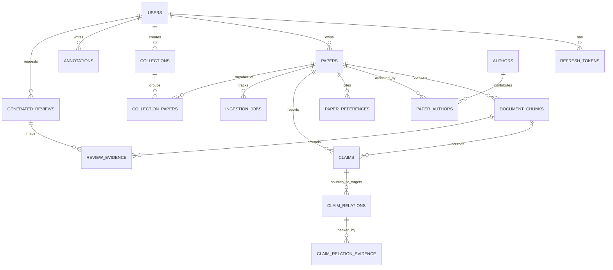

# AI Research Discovery and Evidence Engine

[](https://github.com/airesearch/discovery-engine)
[](https://openjdk.org/projects/jdk/21/)
[](https://spring.io/projects/spring-boot)
[](https://github.com/pgvector/pgvector)
[](https://vitejs.dev/)
[](https://tailwindcss.com/)
[](LICENSE)

An evidence-backed, non-hallucinatory scholarly knowledge engine built for computer science researchers and students. This project enables researchers to ingest academic PDFs, extract structured scientific claims, detect cross-paper contradictions and supporting evidence, explore interactive citation/concept graphs, and generate literature reviews where **every factual sentence is grounded in verbatim chunk citations**.

---

## 1. Problem Statement

Modern generative AI applications applied to scientific literature suffer from **hallucination, ungrounded extrapolation, and fabricated citations**. When a researcher asks an LLM to summarize a scientific debate, the model often invents plausible-sounding authors, papers, and experimental metrics.

Furthermore, traditional search engines (e.g., Google Scholar, PubMed) provide document-level keyword search, but cannot answer multi-paper questions such as:
- *"Does Paper B corroborate or contradict the latency findings of Paper A?"*
- *"Which papers qualify this limitation under different dataset distributions?"*

### Core Philosophy
1. **Never present an AI interpretation as a reported paper fact.**
2. **Never fabricate citations, DOIs, page numbers, authors, or experimental results.**
3. **If evidence is unavailable in the corpus, explicitly say so rather than guessing.**
4. **Distinguish clearly between Reported Evidence, AI Synthesis, and Human Annotations.**

---

## 2. Key Objectives & Features

- **Scholarly PDF Ingestion & Semantic Chunking**: Extract text with Apache PDFBox, detect sections (`Abstract`, `Methodology`, `Results`, `Limitations`), compute character offsets and page mappings, and index chunks with 384-dimensional dense vectors.
- **Dense + Lexical Hybrid Search**: Combines PostgreSQL `pgvector` cosine similarity with PostgreSQL Full-Text Search (FTS) using weighted rank fusion.
- **Structured Paper Comparison Matrix**: Compare 2 to 5 papers side-by-side across Research Problem, Methodology, Datasets, Metrics, Findings, and Limitations, with instant click-to-view chunk evidence.
- **Claims & Evidence Tracking**: Flagship feature extracting atomic scientific claims and tracking directional relationships (`SUPPORTS`, `CONTRADICTS`, `QUALIFIES`, `EXTENDS`, `DISCUSSES`, `DUPLICATES`).
- **Interactive Citation & Concept Graphs**: Visualized using Cytoscape.js, with distinct edge styles distinguishing evidence-backed citations from AI-proposed relationships.
- **Evidence-Backed Literature Reviews**: RAG pipeline generating multi-paragraph reviews with paragraph-to-chunk provenance mappings, coverage warnings, and Markdown/BibTeX export.
- **Zero-Setup Offline Fallback**: Shipped with a deterministic local Mock AI engine so the entire project can be demonstrated, tested, and evaluated without GPU hardware or downloading Ollama models.

---

## 3. System Architecture

The application is structured as a **Modular Monolith** with a decoupled React/TypeScript single-page application:

```mermaid
graph TB
    subgraph Frontend["Frontend Client (React 19 + TypeScript + Vite)"]
        UI[UI Components & Workspaces]
        AuthCtx[Auth Context & JWT Storage]
        Query[TanStack React Query]
        Cyto[Cytoscape.js Graph Engine]
    end

    subgraph Backend["Backend API (Spring Boot 3.3.4 - Java 21)"]
        Sec[Spring Security & JWT Filter]
        subgraph Features["Feature Modules (Package-by-Feature)"]
            AuthModule[auth: JWT & Refresh Tokens]
            PaperModule[paper: Metadata & CRUD]
            IngestModule[ingestion: PDFBox & Chunking]
            SearchModule[search: Hybrid Vector + FTS]
            ClaimModule[claims: Claims & Evidence Relations]
            CompModule[comparison: Aspect Matrix & Synthesis]
            ReviewModule[review: RAG Literature Reviews]
            GraphModule[graph: Citation & Concept Cytoscape Payloads]
        end
        subgraph AI["AI Abstraction Layer"]
            MockAI[MockAiProvider (Deterministic Offline)]
            OllamaAI[OllamaAiProvider (Local LLM & Embeddings)]
        end
    end

    subgraph Database["Storage Tier (PostgreSQL 16)"]
        PgVect[pgvector: 384-d Cosine Distance]
        FTS[Full-Text Search: tsvector & tsquery]
        Flyway[Flyway Database Migrations]
        Disk[Local Upload Directory: Raw PDFs]
    end

    Frontend -->|REST API / JSON| Backend
    Backend -->|Spring JdbcTemplate (No JPA)| Database
    Backend --> AI
```

---

## 4. Database Schema (Entity-Relationship Diagram)



---

## 5. Technology Stack

| Layer | Technologies Selected | Justification |
| :--- | :--- | :--- |
| **Language & Platform** | Java 21 (LTS), OpenJDK | Modern pattern matching, records, virtual threads, high enterprise adoption. |
| **Backend Framework** | Spring Boot 3.3.4 | Spring Web, Spring Security, Spring Validation, Spring JDBC. |
| **Persistence Layer** | Spring `JdbcTemplate` *(Strictly NO JPA/Hibernate)* | Complete SQL transparency, zero N+1 errors, direct use of `pgvector` operators (`<=>`), educational for students. |
| **Database & Search** | PostgreSQL 16 + `pgvector` | Native dense vector cosine distance alongside transactional relational integrity. |
| **Migrations** | Flyway 10 | Version-controlled repeatable database schema migrations. |
| **PDF Processing** | Apache PDFBox 3.0.3 | Robust scholarly text extraction, character offset tracking, and font metadata. |
| **AI Providers** | Offline Mock Provider (Default) / Ollama | Deterministic offline evaluation without requiring external API keys or heavy GPU downloads. |
| **Frontend Framework** | React 19, TypeScript, Vite 8 | Fast HMR, type safety, modular component architecture. |
| **Styling** | Tailwind CSS 4, Lucide React | Curated slate-and-indigo dark theme with glassmorphism and clear provenance indicators. |
| **State & Visualization** | TanStack Query, React Router, Cytoscape.js | Robust server-state caching and interactive network graph physics. |
| **Testing** | JUnit 5, Mockito, MockMvc, Playwright | Comprehensive test pyramid covering unit, database, API, and E2E browser flows. |
| **Containerization** | Docker, Docker Compose | Reproducible local deployment with multi-stage builds. |

---

## 6. Project Directory Structure

```text
ai-research-engine/
├── .github/
│   └── workflows/
│       └── ci.yml                     # Java 21 + Node CI pipeline
├── backend/
│   ├── pom.xml                        # Maven configuration
│   └── src/
│       ├── main/
│       │   ├── java/com/airesearch/discovery/
│       │   │   ├── config/            # Security, CORS, OpenAPI, Database configs
│       │   │   ├── auth/              # JWT, BCrypt, AuthController, AuthService
│       │   │   ├── paper/             # Paper CRUD, Author & Reference repositories
│       │   │   ├── ingestion/         # PDFBox parser, ChunkingService, IngestionService
│       │   │   ├── search/            # Dense vector + Lexical FTS hybrid search
│       │   │   ├── claims/            # Claim extraction & relation validation
│       │   │   ├── comparison/        # Multi-paper aspect matrix & AI synthesis
│       │   │   ├── review/            # RAG literature review generation & export
│       │   │   ├── graph/             # Citation & concept Cytoscape graph payloads
│       │   │   ├── annotation/        # User notes and highlights
│       │   │   ├── collection/        # Research paper groupings
│       │   │   ├── ai/                # EmbeddingProvider, ChatModel, Mock & Ollama
│       │   │   └── shared/            # Enums, DTOs, Provenance taxonomy
│       │   └── resources/
│       │       ├── db/migration/      # Flyway SQL migrations (V1__init_schema.sql)
│       │       └── application.yml    # Application configuration
│       └── test/                      # JUnit 5 & MockMvc test suites
├── frontend/
│   ├── package.json                   # React, Vite, Tailwind 4, Cytoscape dependencies
│   ├── vite.config.ts                 # Dev server proxy configuration
│   ├── e2e/                           # Playwright end-to-end test specs
│   └── src/
│       ├── api/                       # Axios API clients for each backend feature
│       ├── components/                # Badges, Modals, Navbar, Sidebar
│       ├── context/                   # AuthContext with token refresh
│       ├── pages/                     # 12 comprehensive scholarly workspaces
│       └── types/                     # Shared TypeScript domain interfaces
├── docker/
│   ├── Dockerfile.backend             # Multi-stage JDK 21 build
│   ├── Dockerfile.frontend            # Multi-stage Nginx build
│   └── nginx.conf                     # Reverse proxy and SPA routing
├── docs/
│   ├── AI_AND_RAG.md                  # Pedagogical guide on RAG, embeddings & chunks
│   ├── CLAIM_EVIDENCE_MODEL.md        # Formal claim ontology & validation rules
│   ├── LOCAL_SETUP.md                 # Complete local setup instructions
│   ├── TESTING.md                     # Test pyramid & execution commands
│   ├── SECURITY.md                    # Authentication & upload sanitization
│   └── DECISIONS.md                   # Architectural Decision Records (ADR)
├── docker-compose.yml                 # Local Docker deployment
├── .env.example                       # Environment template
└── README.md                          # Project documentation
```

---

## 7. Quickstart & Local Setup

### Option 1: Fast Hybrid Local Setup (Recommended)
```bash
# 1. Start the PostgreSQL with pgvector database
docker compose up -d postgres

# 2. Run the Spring Boot Backend (compiles and seeds 4 seminal papers automatically)
cd backend
mvn spring-boot:run

# 3. In another terminal, start the Frontend dev server
cd frontend
npm install
npm run dev
```
Open your browser at `http://localhost:5173`.

### Option 2: Full Docker Compose Environment
```bash
docker compose up --build -d
```
Open `http://localhost:3000`.

### Seed Accounts
- **Admin**: `admin@airesearch.edu` / `admin123`
- **Student**: `student@airesearch.edu` / `student123`

---

## 8. Running Automated Tests

```bash
# Run all backend unit, integration, and domain tests (8+ suites)
cd backend
mvn clean test

# Run frontend typecheck and build validation
cd frontend
npm run build

# Run Playwright end-to-end browser tests
cd frontend
npm run test:e2e
```

---

## 9. Known Limitations & Future Scope

### Known Limitations
1. **Scanned PDF Limitations**: The default Apache PDFBox extractor targets text-layer PDFs. For rasterized or scanned bitmap PDFs, OCR (e.g., Tesseract) would be required.
2. **Context Window Sizing**: The mock engine processes arbitrary chunk counts; local Ollama models require a context window size of at least 8k tokens when synthesizing large collections.
3. **Complex Formulas**: Mathematical equations expressed in MathML or raw LaTeX font ligatures may extract as plaintext tokens.

### Future Scope
- **GROBID Scholar Enhancement**: Enable the optional GROBID container adapter for enhanced header, table, and reference citation extraction.
- **Multi-Hop Graph Reasoning**: Implementing Graph RAG algorithms to traverse citation paths (Paper A $\rightarrow$ Paper B $\rightarrow$ Paper C) to detect indirect consensus.
- **Collaborative Group Workspaces**: Support live multi-user real-time shared annotation sessions using WebSockets.

---

## 10. License
This project is open-source and licensed under the [MIT License](LICENSE).
